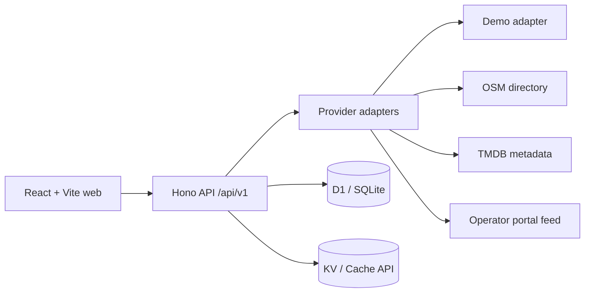

# ShowScout architecture

ShowScout is designed as a static React frontend plus a small edge-friendly API. The current repository keeps the frontend at the root for the simplest local workflow, while the API and domain packages live under `apps/` and `packages/` so they can be split into independent workspaces without changing the product model.

All public records carry source, last-updated time, and data quality. The demo provider is deterministic and is the default until authorized data sources are connected.
## Comparison scoring

`valueScore` is bounded to 0–100 and combines cheapest available price (40%), format quality (25%), available seats (20%), and freshness (15%). Demo records receive a transparent freshness discount. Sorting by `lowest_price`, `most_available`, `earliest`, and `nearest` uses the corresponding real show or theatre fields; missing shows sort last.
